# PyQuiz — Python MCQ exam trainer

An offline-first web app, installable on phone and laptop, to prepare a 40-question / 1-hour
Python multiple-choice exam. **Live app: <https://tkirkis.github.io/python-mcq-trainer/>**

* **Learn** chapter by chapter: a cheat-sheet lesson per topic, then questions easy → hard with
  instant feedback — why the answer is right, why each distractor is wrong, which slides to reread.
* **Practice** with filters (chapter, topic, difficulty, type, weak spots, due for review, never seen,
  past exam only) in 5 / 10 / 20 / endless sessions, or **Smart practice** for a 10-minute commute.
* **Mock exams** that reproduce the real quiz platform: 40 questions, 60-minute timer, question
  sidebar, ANSWER / I DON'T KNOW, no feedback until the end, resume after an interruption, results per
  chapter, full review and "retry only my mistakes". Variants: *same as last year*, *full syllabus*,
  *reference replay* (the 2021-22 exam) and *hard mode*.
* **Spaced repetition**: every wrong, skipped or guessed answer enters a Leitner review queue.
* **Progress**: mastery heatmap, estimated exam score with an honest range, mock history, streak and
  daily goal, confidence check (lucky guesses and overconfidence), most-missed questions.
* **Sync** between devices with a free Supabase project (optional): conflict-free, works offline,
  status shown in the top bar. Export / import a JSON backup at any time.

## The question bank

| Chapter | Slides | Questions | of which past exam | Select-all | Easy / Med / Hard | Verified by execution |
|---|---|---|---|---|---|---|
| S1 Basics | 1–67 | 166 | 16 | 25 | 55 / 74 / 37 | 157 (95%) |
| S2 Functions & data structures | 68–125 | 150 | 10 | 23 | 52 / 65 / 33 | 147 (98%) |
| S3 Files, OS, modules, exceptions | 126–149 | 83 | 3 | 14 | 25 / 38 / 20 | 81 (98%) |
| S4 Under the hood: scopes, aliasing, mutability | 150–181 | 93 | 3 | 15 | 21 / 43 / 29 | 92 (99%) |
| S5 OOP & GUI | 182–213 | 106 | 6 | 17 | 31 / 49 / 26 | 100 (94%) |
| S6 NumPy, Pandas, visualization | 214–246 | 100 | 0 | 16 | 30 / 45 / 25 | 99 (99%) |
| S7 Pythonic code, testing, efficiency | 247–278 | 82 | 2 | 14 | 23 / 38 / 21 | 74 (90%) |
| S8 Web applications | 279–319 | 60 | 0 | 10 | 22 / 27 / 11 | 33 (55%) |
| **Total** | 1–319 | **840** | 40 | 134 (16%) | 259 / 379 / 202 | **783 (93%)** |

* **Every answer key is checked by running the code.** `scripts/verify_questions.py` executes each
  question in a sandboxed `python -I` subprocess (NumPy, Pandas, Matplotlib and Flask included),
  compares the real output with the marked option and fails if a wrong option also matches. Questions
  that cannot be executed (HTTP, PEP 8, MVC, …) are reviewed twice. The build stops on any failure.
* Every question has been reviewed twice; S6–S8 are also verified on NumPy 2.1 / pandas 2.2.
* The 2021-22 exam is included as [`data/reference_exam.json`](data/reference_exam.json); its format,
  patterns and the blueprint used by the mock exams are described in
  [`docs/exam_analysis.md`](docs/exam_analysis.md).
* Add your own questions: [`docs/QUESTION_AUTHORING.md`](docs/QUESTION_AUTHORING.md).

## Use it

Open the live app and install it: on iPhone, Safari → Share → **Add to Home Screen**; on Android,
Chrome → ⋮ → **Install app**; on a laptop, the install icon in the address bar. After the first visit
everything works offline. Sync is optional: Settings → *Sync between devices*.

Keyboard on a laptop: `1`–`6` select · `Enter` check / next · `N` next · `I` I don't know ·
`G` guess / `U` unsure · in mock exams `←` `→` navigate.

## Run your own copy

```bash
npm run setup
```

```bash
npm run dev
```

| Command | |
|---|---|
| `npm run verify` | execute and check every question |
| `npm test` | unit tests: scoring, spaced repetition, score estimate, mock blueprint, sync convergence |
| `npm run e2e` | browser tests: feedback, multi-select, keyboard, mock timer and resume, offline, two-device sync |
| `npm run build` | strict verification + type-check + production build into `dist/` |

Deployment on GitHub Pages, Supabase sync and phone installation: [`docs/SETUP.md`](docs/SETUP.md).
How it works: [`docs/ARCHITECTURE.md`](docs/ARCHITECTURE.md). Release notes: [`CHANGELOG.md`](CHANGELOG.md).

## Screenshots

| | Phone | Laptop |
|---|---|---|
| Home | 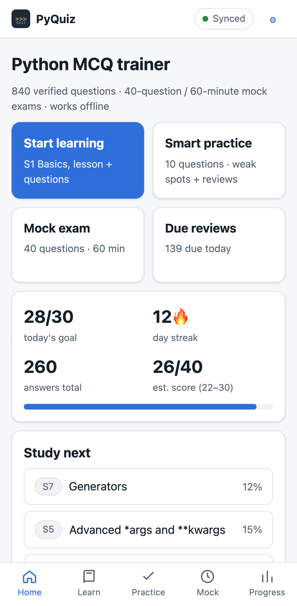 | 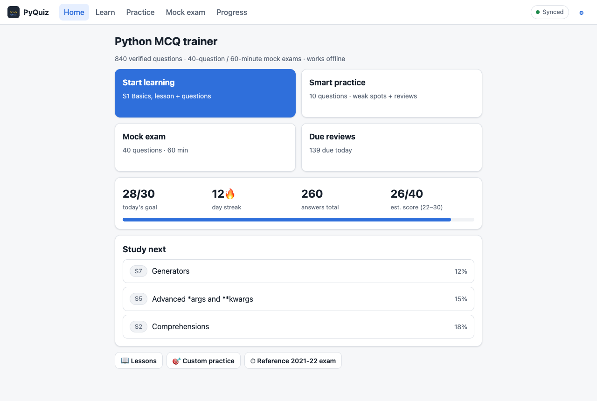 |
| Question | 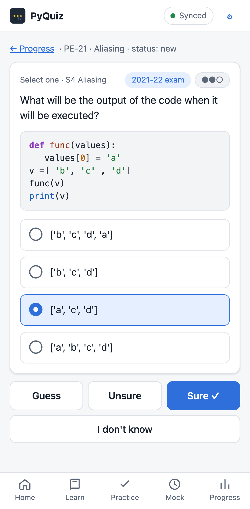 | 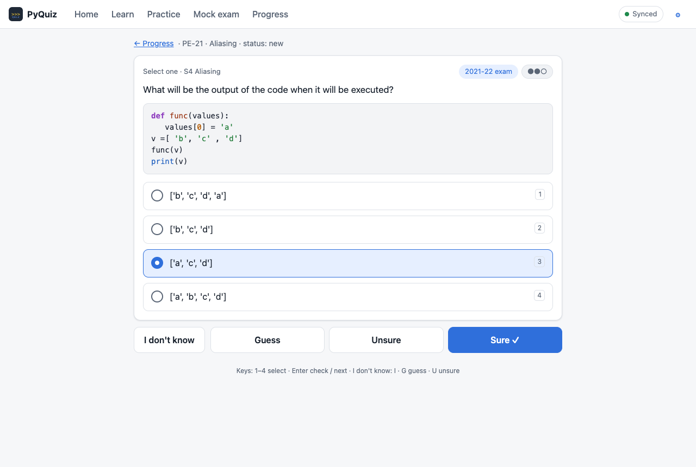 |
| Feedback | 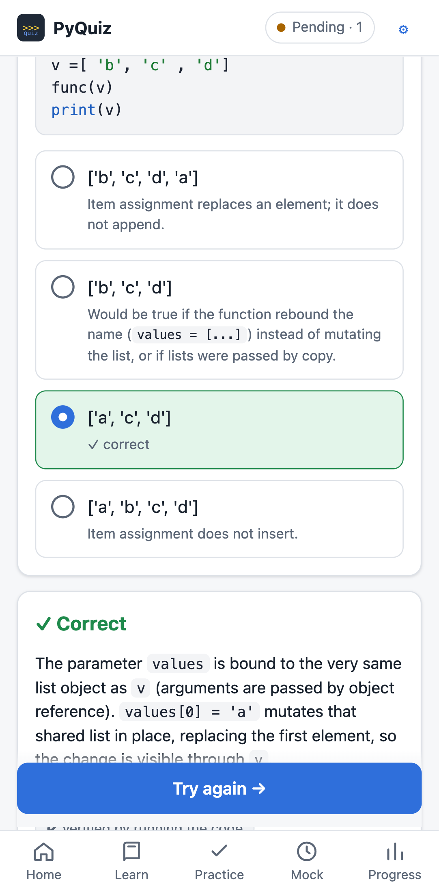 | 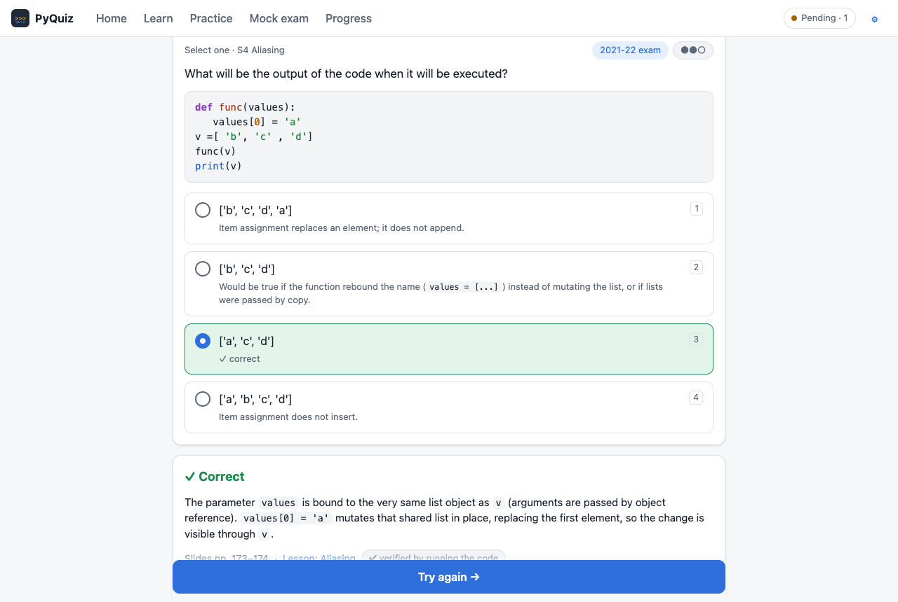 |
| Mock exam | 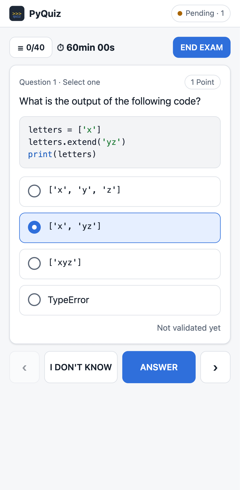 | 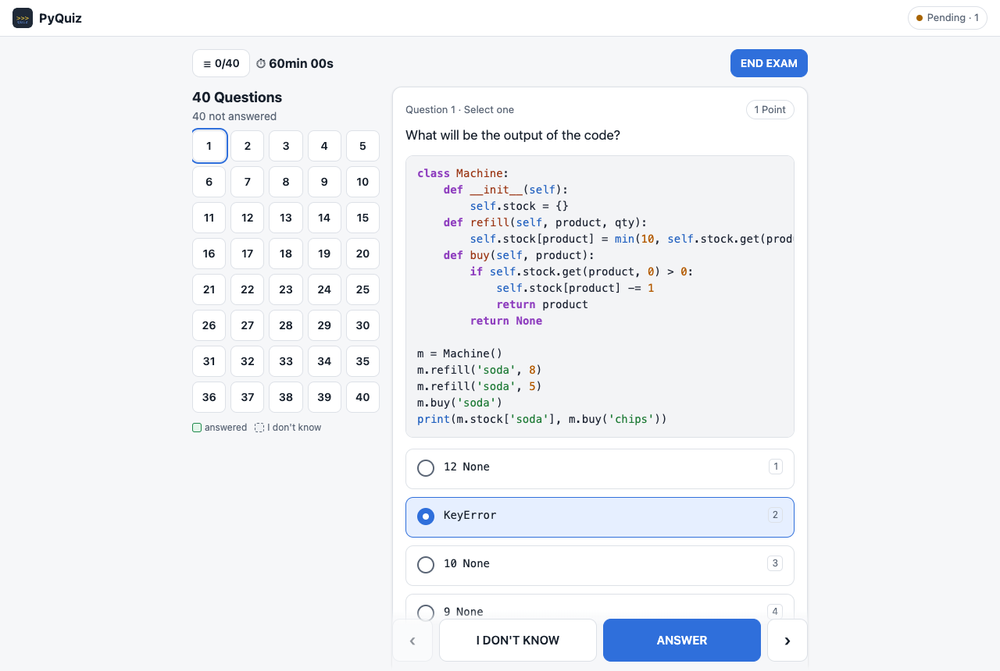 |
| Results | 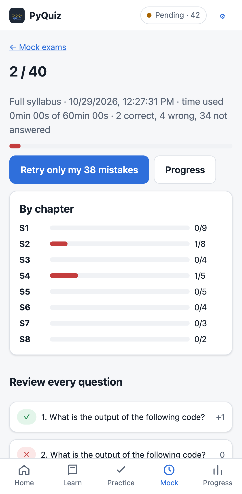 | 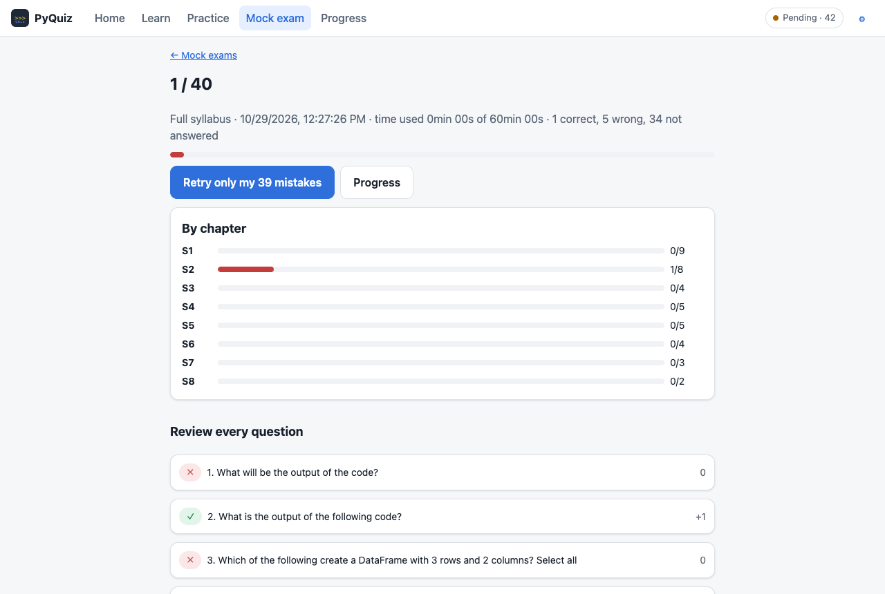 |
| Progress | 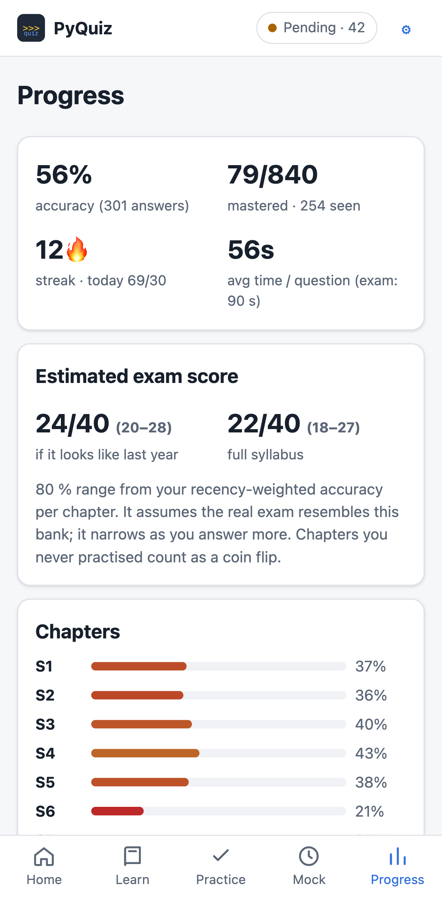 | 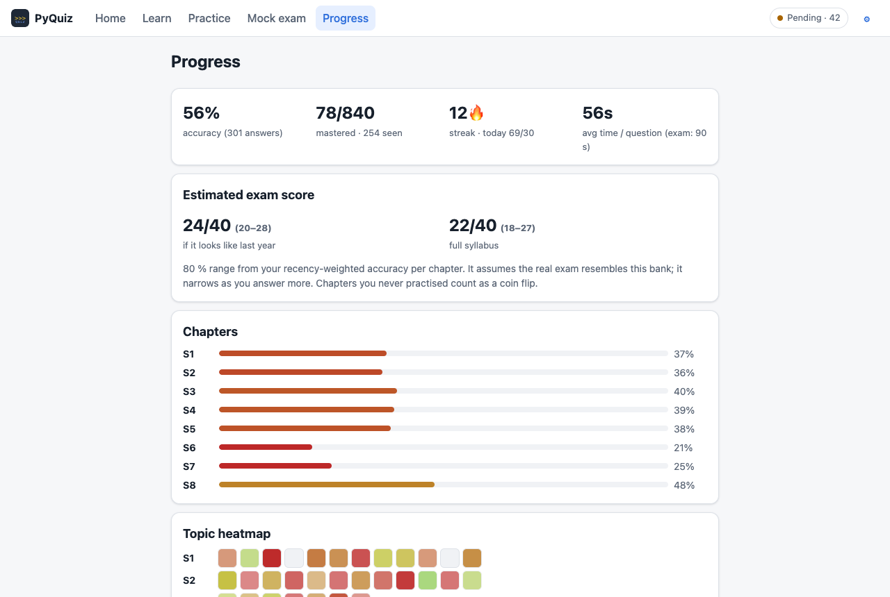 |

## Good to know

* **Scoring.** The default is +1 correct, 0 wrong, 0 "I don't know", and "select all that apply" is
  all-or-nothing. Negative marking and partial credit can be enabled in Settings → *Exam scoring*;
  every mock exam records the rules it used.
* **Mock variants.** *Same as last year* follows the 2021-22 chapter weights; *full syllabus* also
  covers NumPy/Pandas, Pythonic code/testing and web applications.
* **Python version.** Questions follow Python 3 semantics. A few past-exam questions keep quirks of the
  original (e.g. Python 2 `print`) and say so.
* **Estimated score.** It assumes the real exam resembles this bank: read it as a trend.
* **Sync.** Uses your own free Supabase project; free projects pause after 7 days without traffic, so a
  scheduled workflow pings it twice a week. On iPhone, sign in inside the installed app (it has its
  own storage, separate from Safari).
* **Lessons** are concise cheat-sheets that point to the course slides; they do not replace them.
